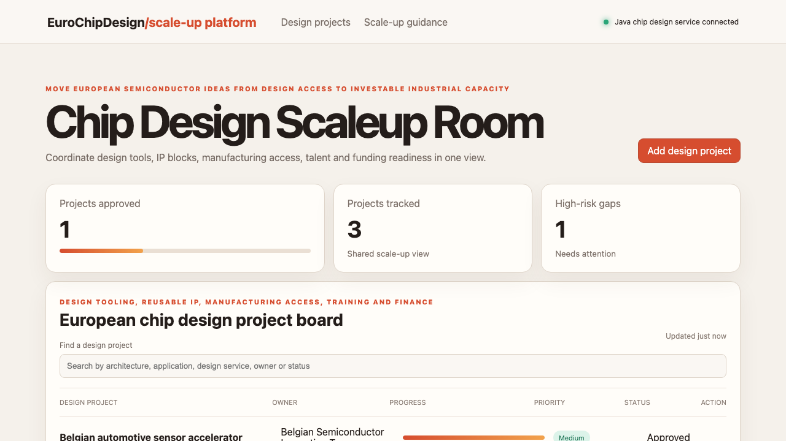

# Chip Design Scaleup Room

## One-sentence benefit
Helps semiconductor start-ups coordinate design access, technical enablement, manufacturing pathways and scale-up funding.

## Live demo
Run the Java service and Angular application locally to use the complete experience.

## Screenshots

## Main features
Search design projects, create a scale-up case, progress readiness work and monitor approval and high-priority delivery gaps.

## Technology used
Angular, TypeScript, signals, computed state, server rendering, Spring Boot and Java.

## Installation instructions
Start the backend with `cd backend && mvn spring-boot:run`. In another terminal run `npm install && npm start`.

## Commercial licensing/contact
Commercial licensing and implementation support are available through the repository owner.

## Business problem and users
Chip design start-ups, research teams, investors and manufacturing partners need shared evidence about tooling, IP, talent, finance and fabrication access.

## Key workflows
Teams can find a design project, add a validated scale-up case and advance technical and investment work to approval.

## Angular framework highlights
The interface uses standalone components, signals, computed values, OnPush change detection, built-in control flow and SSR-safe loading.

## Java backend highlights
The Spring Boot service provides real list, search, create and update endpoints, validation, clear errors, health reporting and tests.

## Architecture and state flow
Angular HttpClient connects signal-based state to the Java API and updates the visible board after every write.

## Accessibility and responsive behaviour
Semantic structure, labelled controls, visible focus, high contrast and compact responsive tables support varied users and devices.

## Verification commands
Use `npm test -- --watch=false`, `npm run build`, and `cd backend && mvn test package`.

## Structure
`src` contains the Angular experience, `backend` contains the Java service, and `docs` contains verified media.

## Tradeoffs
Records are held in memory for demonstration speed; operational use would add identity, durable evidence, design-platform imports and funding integrations.

## Roadmap
Add tool-access requests, IP block catalogues, tape-out milestones, funding scenarios and audit-ready persistence.
